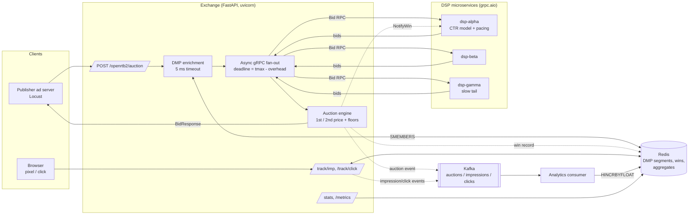

# BidStorm

A real-time bidding (RTB) ad exchange simulator built to keep auctions under a
**100 ms** budget. Publisher ad servers send OpenRTB-style bid requests to the
exchange. The exchange adds audience segments from a Redis-backed DMP, then sends the
request to a pool of DSP microservices over **gRPC**, all at the same time. DSPs that
miss the deadline are dropped. The exchange runs a **first- or second-price auction**
and returns the winning ad. Auction, impression and click events go to **Kafka**, and
an analytics consumer rolls them up into live KPIs.

Each DSP prices impressions with a **scikit-learn CTR model**: logistic regression on
hashed features, trained on synthetic logs with known click effects. Each DSP also has
its own targeting, value per click and budget pacing.

## Architecture



### Request lifecycle and latency budget

```
t=0     request parsed and validated (pydantic)
t≈1ms   DMP lookup (Redis SMEMBERS, hard 5 ms timeout -> empty segments on miss)
        budget = min(request.tmax, EXCHANGE_TMAX_MS) - EXCHANGE_OVERHEAD_MS - elapsed
t≈1ms   Bid RPC sent to every DSP at once with gRPC deadline = budget
        asyncio.wait(timeout=budget); unfinished calls are cancelled -> counted as timeouts
t≤70ms  auction cleared per impression; response returned
async   win notices -> DSPs (pacing), win record -> Redis, auction event -> Kafka
```

### Components

| Path | Role |
| --- | --- |
| `bidstorm/models.py` | OpenRTB 2.5 subset (`BidRequest`, `Imp`, `BidResponse`, ...) |
| `bidstorm/proto/bidding.proto` | gRPC `Bidder` service: `Bid`, `NotifyWin` |
| `bidstorm/exchange/auction.py` | Pure auction engine: floors, first/second price, tie-breaks |
| `bidstorm/exchange/fanout.py` | Concurrent gRPC fan-out with deadline enforcement |
| `bidstorm/exchange/dmp.py` | Redis DMP client with timeout-bounded lookups |
| `bidstorm/exchange/service.py` | Orchestrates enrich → fan-out → auction → side effects |
| `bidstorm/exchange/tracking.py` | Server-side win records; deduplicated pixels |
| `bidstorm/exchange/app.py` | FastAPI app: auction, tracking, `/stats`, `/metrics` |
| `bidstorm/dsp/server.py` | Async gRPC DSP with simulated latency and a slow tail |
| `bidstorm/dsp/bidder.py` | pCTR × value-per-click CPM, targeting boost, shading, pacing |
| `bidstorm/ml/` | Feature hashing, synthetic log generator, CTR trainer |
| `bidstorm/events/` | Event schema + Kafka / null / in-memory publishers |
| `bidstorm/analytics/` | Kafka consumer + Redis roll-ups (fill rate, win rate, CTR, eCPM) |
| `docker-compose.yml`, `k8s/` | Local stack and Kubernetes manifests (HPA on the exchange) |
| `loadtest/locustfile.py` | Load test that counts responses over 100 ms as failures |

### Key design choices

- **Second price** charges `max(runner-up, floor) + $0.01`, never more than the
  winner's bid. **First price** charges the bid itself, so DSPs bid only 80% of their
  value in first-price auctions.
- **Deadlines are enforced twice.** The gRPC deadline lets DSPs give up early. The
  exchange's own `asyncio.wait` timeout means a slow client can never push the auction
  past its budget.
- **Nothing on the hot path waits for analytics or tracking.** Win records, Kafka
  publishing and win notices run as background tasks. Kafka is best-effort. Clearing
  prices are stored on the server, not put in pixel URLs, so they can't be forged.
- **The same feature code is used for training and serving** (`ml/features.py`), so
  the two can't drift apart. DSPs score with a plain dot product, not
  `predict_proba`, to keep per-request overhead in the microseconds.
- **The analytics consumer is at-least-once.** It commits Kafka offsets only after a
  batch has been written to Redis in one pipeline.

## Running it

### Docker Compose (whole stack)

Needs Docker with about 4 GB of memory. The image build trains the CTR model
(~150k synthetic rows, under a minute).

```bash
docker compose up --build -d            # redis, kafka, 3 DSPs, exchange, analytics, DMP seed
curl -s localhost:8000/healthz

curl -s -X POST localhost:8000/openrtb2/auction -H 'content-type: application/json' -d '{
  "id": "demo-1",
  "imp": [{"id": "1", "banner": {"w": 300, "h": 250, "pos": 1}, "bidfloor": 0.25}],
  "site": {"id": "s1", "domain": "espn.example", "cat": ["IAB17"]},
  "device": {"devicetype": 4, "os": "ios", "geo": {"country": "US"}},
  "user": {"id": "u42"},
  "tmax": 100,
  "at": 2
}' | jq

curl -s localhost:8000/stats | jq          # fill rate, per-DSP win rate / timeouts / CTR / eCPM
curl -s localhost:8000/metrics | grep bidstorm_auction_latency
```

A `204` response means no bid: no DSP bid above the floor in time.

### Local processes (no Docker)

You need Python 3.11+, plus Redis on `localhost:6379`. Kafka is optional: set
`KAFKA_ENABLED=false` to skip it.

```bash
python -m venv .venv && source .venv/bin/activate
make install proto                   # deps + generate gRPC stubs
cp .env.example .env
make train                           # writes models/ctr.joblib and prints AUC / log-loss
make seed                            # 50k users -> DMP

DSP_NAME=dsp-alpha DSP_PORT=50051 make dsp &
DSP_NAME=dsp-beta  DSP_PORT=50052 DSP_TARGET_SEGMENTS=finance,tech make dsp &
DSP_NAME=dsp-gamma DSP_PORT=50053 DSP_LATENCY_MS=40 make dsp &
make exchange
make analytics                       # in another shell, if Kafka is running
```

### Kubernetes

```bash
docker build -f docker/Dockerfile -t bidstorm:latest .
# load the image into your cluster (kind load docker-image / minikube image load / push to a registry)
kubectl apply -f k8s/
kubectl -n bidstorm port-forward svc/exchange 8000:80
```

The manifests expect a Kafka bootstrap service called `bidstorm-kafka-bootstrap` (for
example, from Strimzi). Change `KAFKA_BOOTSTRAP` in `k8s/01-configmap.yaml` to point
elsewhere. DSP services are headless, so the exchange's gRPC channels spread calls
across DSP pods.

### Configuration

All settings come from environment variables; see `.env.example`. The main ones:

| Variable | Default | Meaning |
| --- | --- | --- |
| `EXCHANGE_TMAX_MS` | 80 | Upper limit on the auction budget (the request `tmax` can only lower it) |
| `EXCHANGE_OVERHEAD_MS` | 10 | Time held back for the auction and serialization |
| `EXCHANGE_DSP_ENDPOINTS` | — | `name=host:port,...` |
| `DMP_TIMEOUT_MS` | 5 | DMP lookup budget |
| `KAFKA_ENABLED` | true | Set to `false` to use a no-op publisher |
| `DSP_VALUE_PER_CLICK` / `DSP_DAILY_BUDGET` / `DSP_TARGET_SEGMENTS` | — | Per-DSP economics |
| `DSP_LATENCY_MS` / `DSP_LATENCY_JITTER_MS` | 5 / 10 | Simulated DSP latency (plus 2% of calls at 150 ms) |

## Testing

### Unit and integration tests

```bash
make install
make test            # runs `make proto` then pytest
```

The tests need no running services. Redis is replaced by `fakeredis`, DSPs by
in-process fake bidders, and Kafka by an in-memory publisher. If the gRPC stubs are
missing, `tests/conftest.py` generates them. Coverage:

- `test_auction.py`: second-price and first-price clearing, floors, ties, bad bids,
  multiple impressions.
- `test_fanout.py`: stragglers dropped at the deadline, errors, no-bids, arrival order.
- `test_api.py`: the full HTTP flow, 204 for no-bid, DMP segments passed to DSPs,
  `tmax` tightening the budget, tracking pixel dedupe and events, metrics.
- `test_bidder.py` / `test_features.py`: valuation, shading, targeting, pacing, and
  feature hashing.
- `test_dmp.py`, `test_events.py`, `test_aggregator.py`: DMP lookups that degrade
  safely, event round-trips, KPI roll-ups.

### Load testing

```bash
# against the compose stack, with the web UI on :8089
docker compose --profile load up locust

# or headless from the host
locust -f loadtest/locustfile.py --host http://localhost:8000 \
  --headless -u 200 -r 50 -t 2m --csv results/run1
```

Locust counts any auction slower than 100 ms as a failure, so its failure rate is the
SLA-violation rate. It prints p50, p95 and p99 when it exits. Rendered ads fire the
impression pixel (90%) and sometimes a click (3%), which drives the Kafka → analytics
pipeline. Watch `/stats` during the run.
